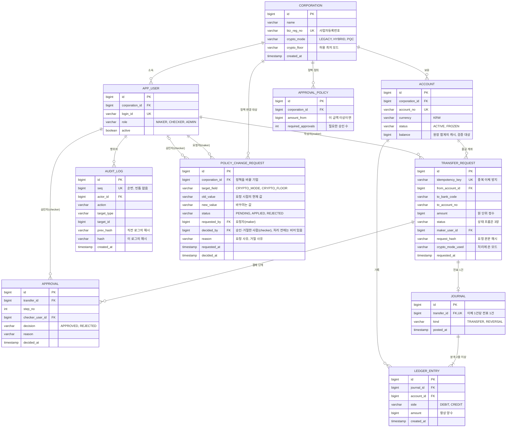
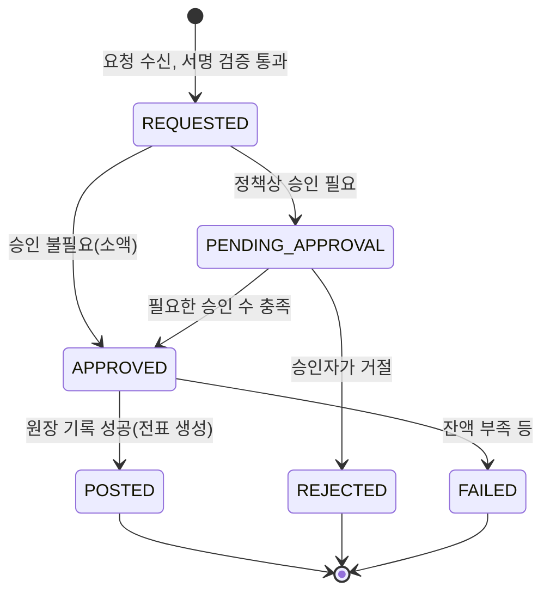
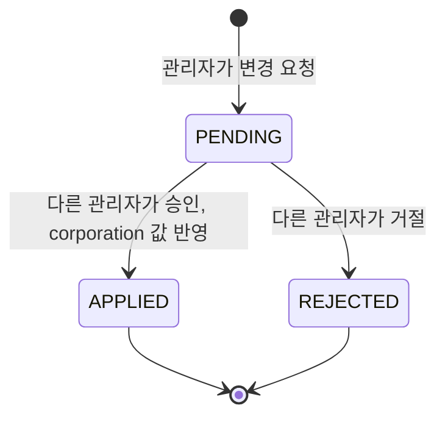

# ERD: 이체 · 원장 · 결재 (v0.2, W1 초안. 정책 변경 승인 테이블 추가)

> 목적: 이체 한 건이 DB에 어떻게 기록되는지 정한다. 이체 API, 결재 엔진, 원장, 대사 배치가 모두 이 구조를 쓴다.
> v0.2 변경: 위협 T13(내부자 단독 정책 변경) 대응으로 `policy_change_request` 테이블과 규칙 R8~R10을 추가했다.
> 상태: 초안. 팀원과 검토해 W1 말 "계약 확정"에서 고정한다. 고정 후 변경은 서로 알린다(PR + ADR).
> DB: PostgreSQL. 스키마 변경은 Flyway 마이그레이션 파일로만 한다.

## 1. 한 장 그림

## 2. 테이블이 하는 일 (한 줄 설명)

| 테이블 | 한 줄 설명 | 이 테이블이 막는 문제 |
| --- | --- | --- |
| `corporation` | 기업 고객. 암호 모드(LEGACY, HYBRID, PQC)와 허용 최저 모드를 기업별로 가진다 | 다운그레이드: 최저 모드 밑으로 못 내리게 함 |
| `app_user` | 이체를 만들거나 승인하는 사용자와 역할 | 권한 없는 사람의 이체 |
| `account` | 계좌. `balance`는 편의용 합계이고 원장과 맞는지 매일 검증한다 | 잔액 불일치 |
| `approval_policy` | "이 금액 이상이면 승인 N명" 규칙 | 고액을 혼자 보내는 것 |
| `transfer_request` | 이체 요청 한 건. `idempotency_key`가 유니크 | 같은 요청이 두 번 처리되는 것 |
| `approval` | 결재 한 단계의 기록 | 만든 사람이 직접 승인 |
| `policy_change_request` | 기업의 암호 모드·최저 모드를 바꾸려는 요청과 승인 기록. 승인되어야만 `corporation` 값이 바뀐다 | 관리자 한 명이 혼자 최저 모드를 낮추는 것(T13) |
| `journal` | 이체가 확정될 때 만드는 전표(거래 묶음) | 한 이체가 반쯤만 기록되는 것 |
| `ledger_entry` | 전표 안의 분개 줄(차변/대변) | 돈이 생기거나 사라지는 것 |
| `audit_log` | 누가 무엇을 했는지 이어 붙인 기록. 각 줄이 앞 줄 해시를 포함 | 기록 삭제·위조 |

## 3. 이체 상태 흐름

상태는 앞으로만 간다. 되돌릴 때는 상태를 고치지 않고 **역분개 전표**(`journal.kind = REVERSAL`)를 새로 만든다.

### 3-1. 정책 변경 상태 흐름

승인과 `corporation` 값 반영은 **한 트랜잭션**에서 한다. 승인만 되고 반영이 안 된 중간 상태는 만들지 않는다. 이미 반영된 변경을 되돌릴 때도 상태를 고치지 않고 **반대 방향의 새 요청**을 만든다(같은 승인 절차를 거친다).

## 4. 반드시 지킬 규칙 (DB와 코드에서 같이 막는다)

| 번호 | 규칙 | 막는 방법 |
| --- | --- | --- |
| R1 | 같은 `idempotency_key`는 한 번만 처리 | `transfer_request.idempotency_key` UNIQUE. 중복 요청은 기존 결과를 돌려줌 |
| R2 | 한 전표의 차변 합계 = 대변 합계 | 전표 확정 시 서비스에서 검증 + 대사 배치에서 재검증 |
| R3 | 원장은 수정·삭제하지 않는다 | `ledger_entry`에 UPDATE·DELETE 권한을 주지 않음. 정정은 역분개 |
| R4 | 만든 사람과 승인한 사람은 달라야 한다 | `approval.checker_user_id <> transfer_request.maker_user_id`를 서비스 검증 + 가능하면 DB 제약 |
| R5 | 금액은 원 단위 정수 | `amount` BIGINT, 소수점 사용 안 함, 0 이하 금지(CHECK) |
| R6 | 감사 로그는 추가만 한다 | `audit_log`는 INSERT만 허용, `seq`로 빈틈 검사, 해시 체인 검증 |
| R7 | 기업의 암호 모드는 `crypto_floor` 아래로 내릴 수 없다 | 모드 변경 시 서비스 검증 + 감사 로그 기록 |
| R8 | 정책 변경의 요청자와 승인자는 달라야 한다 | `policy_change_request`의 CHECK 제약: `decided_by IS NULL OR decided_by <> requested_by`. 같은 테이블 안의 두 열이라 R4와 달리 DB가 직접 강제할 수 있다 |
| R9 | 기업의 암호 모드·최저 모드는 승인된 요청으로만 바뀐다 | `corporation`을 바꾸는 코드를 한 서비스로 모으고, 요청·승인·반영을 모두 `audit_log`에 남긴다(`target_type = POLICY_CHANGE`). `status`와 `decided_by`의 일관성도 CHECK로 강제: `(status = 'PENDING') = (decided_by IS NULL)` |
| R10 | 같은 기업의 같은 항목에 처리 대기 요청은 하나만 | 부분 유니크 인덱스: `UNIQUE (corporation_id, target_field) WHERE status = 'PENDING'`. 동시에 두 요청이 승인되어 값이 꼬이는 것을 막는다 |

## 5. 아직 정하지 않은 것 (팀이 정할 것)

1. 결재 승인 수가 2명 이상일 때 같은 사람이 두 번 승인하지 못하게 할지(권장: `UNIQUE(transfer_id, checker_user_id)`)
2. 입금 계좌가 우리 DB에 없는 타 은행 계좌일 때의 처리(현재는 `to_bank_code` + `to_account_no`만 기록)
3. `account.balance` 캐시를 둘지, 항상 원장 합계로 계산할지(성능 vs 단순함, W9 성능 측정 때 판단)
4. 일 마감 대사 결과 테이블(`daily_reconciliation`)은 W8에 추가한다. 지금은 ERD에 넣지 않는다.
5. 컬럼 이름은 영문 snake_case를 쓰고, 한글 설명은 이 문서의 표에만 둔다.
6. 정책 변경 중 최저 모드를 **올리는** 변경(보안 강화)도 같은 승인 절차를 거칠지, 내리는 변경만 승인할지. 초안은 구분 없이 모두 승인 대상으로 한다(규칙이 단순함).
7. 승인할 수 있는 관리자가 한 명뿐인 기업은 정책을 바꿀 수 없다. 의도된 동작이지만, 데모 데이터에 관리자를 2명 이상 만들어 둔다.
8. 정책 변경 요청이 오래 처리되지 않을 때 만료시킬지(`EXPIRED` 상태 추가). 초안은 만료 없이 둔다.
9. 구·신 모드를 함께 허용하는 전환 기간(위협 모델 T10)의 종료 시각을 어디에 저장할지(예: `corporation.transition_until`). W5~W6 무중단 전환 설계 때 정한다.
