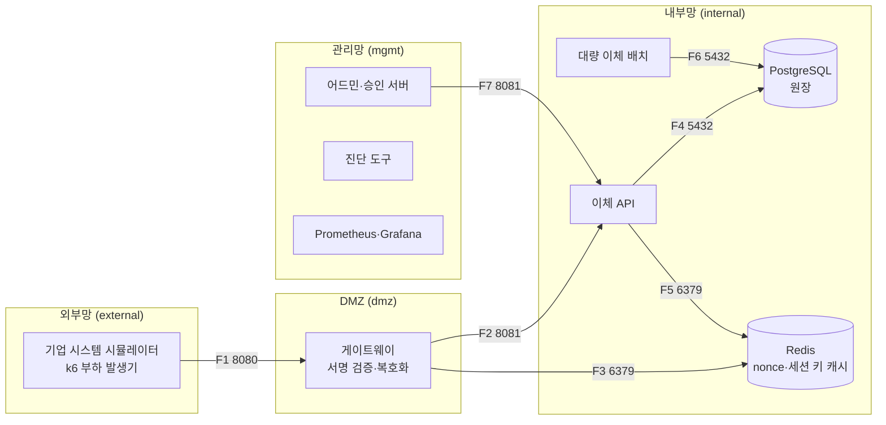

# 네트워크 구조 (v0.1, W1 초안)

> 목적: 서비스들을 **4개 구역**으로 나누고, 어느 구역끼리 어떤 통신을 허용할지 정한다. 한 곳이 뚫려도 피해가 번지지 않게 하는 것이 목표다.
> 상태: 초안. 팀원 검토 후 W1 말 "계약 확정"에서 고정한다. 실제 앱 서비스는 W2~W3에 `infra/docker-compose.yml`에 추가한다.
> 관련 문서: `docs/threat-model.md`(2장 신뢰 경계), `docs/benchmark-plan.md`(장애 주입), `infra/docker-compose.yml`(실제 설정)

## 1. 한 장 그림



한 줄 요약: **외부에서 들어오는 문은 게이트웨이 하나뿐이고, 게이트웨이는 원장 DB에 직접 닿지 않는다.** 원장은 이체 API를 통해서만 바뀐다.

## 2. 구역별 역할

| 구역 | Compose 네트워크 | 들어 있는 것 | 바깥으로 나가는 길 | 호스트(내 컴퓨터)에서 접속 |
| --- | --- | --- | --- | --- |
| 외부망 | `external` | 기업 시스템 시뮬레이터, 부하 발생기(k6) | 있음 | 게이트웨이 8080 |
| DMZ | `dmz` | 게이트웨이, Redis(연결만) | 없음 | 불가 |
| 내부망 | `internal` | 이체 API, 배치, PostgreSQL, Redis | 없음 | 불가(`docker compose exec`로만) |
| 관리망 | `mgmt` | 어드민 서버, 진단 도구, Prometheus, Grafana, Toxiproxy | 있음 | 대시보드만(`127.0.0.1`) |

"바깥으로 나가는 길 없음"은 Compose의 `internal: true` 설정이다. 내부망의 서비스가 침해되어도 인터넷으로 데이터를 보낼 수 없게 한다.

## 3. 허용하는 통신

표에 없는 통신은 모두 **막는 것이 원칙**이다.

| 번호 | 출발 | 도착 | 포트 | 목적 | 지키는 것 |
| --- | --- | --- | --- | --- | --- |
| F1 | 기업 시스템(외부망) | 게이트웨이 | 8080 | 이체 요청 수신. 로컬은 HTTP, 클라우드는 TLS | 외부 입구를 하나로 제한 |
| F2 | 게이트웨이 | 이체 API | 8081 | 서명 검증과 복호화를 마친 요청 전달 | DMZ에서 내부망으로 가는 유일한 문 |
| F3 | 게이트웨이 | Redis | 6379 | nonce 등록, 세션 키 캐시 | T3 재전송 방어 |
| F4 | 이체 API | PostgreSQL | 5432 | 원장·전표·결재 기록 | A2 원장 |
| F5 | 이체 API | Redis | 6379 | (사용 여부 미정, 열린 질문 1번) | |
| F6 | 배치 | PostgreSQL | 5432 | 대량 이체와 일마감 대사 | |
| F7 | 어드민 서버 | 이체 API | 8081 | 결재 승인·거절, 정책 변경 승인. 로그인 토큰(JWT) 필요 | T6, T13 maker-checker |

포트 번호는 제안이다. 8080은 `openapi.yaml`의 서버 주소와 같고, 8081은 임의로 정했다.

## 4. 일부러 막는 통신

| 막는 길 | 이유 |
| --- | --- |
| 외부망 → 내부망 직접 | 외부에서 이체 API나 DB로 우회하면 서명 검증을 건너뛴다 |
| **게이트웨이 → PostgreSQL** | 게이트웨이는 외부와 가장 가까워 침해 위험이 크다. 뚫려도 원장에 직접 닿지 못하게 한다 (A2) |
| 어드민·관리망 → PostgreSQL 직접 | 승인 절차(maker-checker)와 감사 로그를 거치지 않는 변경을 막는다. 관리 기능은 이체 API를 통해서만 |
| 내부망·DMZ → 인터넷 | 침해 시 데이터 유출 경로 차단 |
| 호스트의 외부 접속 → Redis, PostgreSQL | 개발 중에도 DB를 바깥에 열지 않는다 |

## 5. Compose 구조의 한계 (알고 쓰기)

1. **포트 단위 차단은 안 된다.** Compose 네트워크는 "같은 네트워크 안의 서비스끼리는 모든 포트로 통신 가능"이다. 그래서 "게이트웨이는 Redis의 6379만"처럼 정확히 제한하지 못하고, **서비스가 어느 구역에 있는지**로만 나눈다. 포트 단위 제한은 클라우드 보안그룹(W8)과 Redis·DB 계정 권한으로 보완한다.
2. **내부망은 호스트에서 직접 접속할 수 없다.** DB를 들여다볼 때는 `docker compose exec postgres psql ...`을 쓴다.
3. **게이트웨이가 아직 없어서 `external` 네트워크는 비어 있다.** 앱을 추가하기 전까지 `docker compose config` 결과에는 나타나지 않는 것이 정상이다.
4. **로컬 HTTP, 클라우드 TLS.** 로컬 개발은 HTTP로 하고 TLS는 W7~W8에 켠다.

클라우드에서는 4개 구역이 서브넷과 보안그룹에 대응한다. 구체적인 구성은 AWS 또는 NCP를 정한 뒤 W8에 적는다.

## 6. 실행해 보기

```
cp infra/.env.example infra/.env
docker compose -f infra/docker-compose.yml --env-file infra/.env up -d
docker compose -f infra/docker-compose.yml --env-file infra/.env ps
```

- 성공하면 `postgres`, `redis`, `prometheus`, `grafana`가 `running`이고, `postgres`와 `redis`는 `healthy`다.
- 대시보드: Prometheus `http://127.0.0.1:9090`, Grafana `http://127.0.0.1:3000`
- 장애 주입 도구는 평소엔 켜지 않는다. `--profile chaos`를 붙일 때만 시작한다.
- `infra/.env`는 Git에 올라가지 않는다(`.gitignore`). `.env.example`의 값은 로컬 전용 가짜 값이다.

끝내려면 다음을 쓴다. 데이터(볼륨)는 남는다. 데이터까지 지우려면 `down` 뒤에 `-v`를 붙인다.

```
docker compose -f infra/docker-compose.yml --env-file infra/.env down
```

### 6-1. 구역 분리가 실제로 되는지 확인하기

구역(네트워크)별로 임시 컨테이너를 만들어 접속해 본다. 임시 컨테이너는 끝나면 자동으로 사라진다. 네트워크 이름은 `pqc-transfer_<구역>` 형식이다. 막혀야 하는 시험은 일부러 실패하는 것이 정상이며, Docker가 오류 안내 문구를 덧붙일 수 있다.

| 번호 | 시험 | 명령(끝부분) | 기대 결과 | 관련 통신 |
| --- | --- | --- | --- | --- |
| 1 | 내부망 → PostgreSQL | `--network pqc-transfer_internal postgres:16 pg_isready -h postgres -p 5432` | `accepting connections` | F4, F6 |
| 2 | DMZ → PostgreSQL | `--network pqc-transfer_dmz postgres:16 pg_isready -h postgres -p 5432 -t 3` | `no response` (막힘) | 4장: 게이트웨이 → DB 금지 |
| 3 | DMZ → Redis | `--network pqc-transfer_dmz redis:7 redis-cli -h redis -a <비밀번호> --no-auth-warning ping` | `PONG` | F3 |
| 4 | 관리망 → Redis | `--network pqc-transfer_mgmt redis:7 redis-cli -h redis -a <비밀번호> --no-auth-warning ping` | `No address associated with hostname` (막힘) | 4장: 관리망 → 내부 서비스 금지 |
| 5 | 내부망 → 인터넷 | `--network pqc-transfer_internal busybox wget -T 3 -qO- http://example.com` | `bad address` (막힘) | 4장: 내부망 → 인터넷 금지 |

각 명령은 `docker run --rm`으로 시작한다. 예: `docker run --rm --network pqc-transfer_dmz postgres:16 pg_isready -h postgres -p 5432 -t 3`

### 6-2. 검증 상태

| 확인 | 결과 | 확인한 날 |
| --- | --- | --- |
| 설정 문법(`docker compose config`)과 구조(네트워크 연결, 호스트 포트 공개 범위) | 통과 | 2026-11-25 |
| 서비스 실제 기동(`up -d`) | `postgres`, `redis`, `prometheus`, `grafana` 모두 `Up`, `postgres`와 `redis`는 `healthy` | 2026-11-25 (Windows, Docker Desktop, WSL 2) |
| 호스트 포트 공개 범위 | `grafana`, `prometheus`만 `127.0.0.1`에 공개. `postgres`, `redis`는 공개 안 됨 | 2026-11-25 |
| 구역 분리 시험 1~5 | 5개 모두 기대 결과 | 2026-11-25 |

이미지 버전 네 개(`postgres:16`, `redis:7`, `prom/prometheus:v2.55.1`, `grafana/grafana:11.3.0`)는 실제로 내려받아졌다. `toxiproxy`(장애 주입)는 `--profile chaos` 기동을 아직 확인하지 않았다. 앱 서비스(게이트웨이, 이체 API)가 없으므로 F1, F2, F5, F7 통신은 W3 이후 확인한다.

## 7. 아직 정하지 않은 것 (팀이 정할 것)

1. **Redis를 DMZ와 내부망 양쪽에 연결하는 방식**(현재 안). 게이트웨이가 nonce를 등록해야 해서 필요하다. 대안은 DMZ 전용 Redis와 내부 Redis를 따로 두는 것으로, 더 안전하지만 서비스가 하나 늘고 nonce 저장소가 둘로 갈라진다. 이체 API가 Redis를 쓸지(F5)도 같이 정한다.
2. **Redis가 재시작될 때 nonce가 사라지는 문제.** nonce는 10분 보관인데 그 사이에 Redis가 재시작되어 기록이 지워지면, 이미 쓴 요청을 다시 보낼 수 있다. 현재 안은 AOF 저장을 켜서 막는다. 이 상황을 장애 시험(`benchmark-plan.md` M6)에 추가할지 정한다.
3. **어드민이 이체 API에 접근하는 경로**: 현재는 어드민 서버를 관리망과 내부망 양쪽에 연결한다(F7). 대안은 어드민도 게이트웨이를 거치게 하는 것인데, 게이트웨이는 기업 요청의 서명 검증용이라 맞지 않는다.
4. **Prometheus가 DMZ·내부망 서비스의 지표를 가져오는 방법**: 모든 서비스를 관리망에도 연결하면 구역 분리가 약해진다. 영역별로 지표 수집기(exporter)를 둘지 W8에 정한다.
5. **진단 도구의 결과 저장 위치**: PostgreSQL의 별도 스키마인지 파일인지. 전자라면 관리망에서 DB로 가는 통신(F8)이 새로 필요하고, 4장의 "관리망 → PostgreSQL 직접 금지"와 충돌한다.
6. **포트 번호 확정**: 이체 API 8081은 임의 값이다.
7. **이미지 버전 고정**: 지금은 임시 버전이다. W2에 사용할 버전을 확인해 고정한다.
